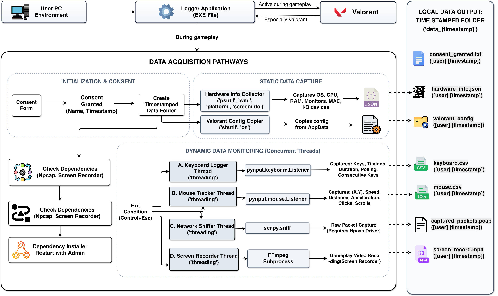

# BEACON-Logger

**A behavioural authentication and network traffic logger for game environments.**

[](https://arxiv.org/abs/2605.10867)
[](https://doi.org/10.5281/zenodo.20144661)
[](https://huggingface.co/datasets/beacon-gui/BEACON-Dataset)
[](LICENSE)

BEACON-Logger is the data acquisition tool behind the
[BEACON dataset](https://huggingface.co/datasets/beacon-gui/BEACON-Dataset). It runs
in the background during a gameplay session and records five synchronised streams:
keystroke dynamics, mouse kinematics, network traffic, screen video and hardware
metadata. It also captures the game's local configuration, so that sensitivity and
keybind differences can be accounted for in behavioural models.

It was built for research on **continuous authentication** and **behavioural
biometrics**, where the question is whether the way a person uses their computer can
identify them reliably for as long as they are at the machine.

<p align="center">
  
</p>

## Timeline

| Date | Milestone |
|---|---|
| Jan 2025 | Logger development begins |
| Apr 2025 | Development of the backend that receives participant uploads begins |
| Jun 2025 | Participant upload portal development begins |
| 2025 | Six-month data collection campaign in Lab L301, Thapar Institute of Engineering & Technology |
| Aug 2025 | Final changes to the logger before release |
| 29 Apr 2026 | BEACON dataset published on Hugging Face |
| 7 May 2026 | **v1.0.0** released on Zenodo ([10.5281/zenodo.20062628](https://doi.org/10.5281/zenodo.20062628)) |
| 11 May 2026 | Paper published on arXiv ([2605.10867](https://arxiv.org/abs/2605.10867)) |
| 13 May 2026 | **v2.0.0** released on Zenodo ([10.5281/zenodo.20144661](https://doi.org/10.5281/zenodo.20144661)) |

The Git history of this repository mirrors the Zenodo releases, with one commit and
tag per release, dated to its publication. Zenodo remains the archival record.

## What it records

| Stream | Output | Details |
|---|---|---|
| Keyboard | `keyboard_<user>_<time>.csv` | Press and release times, hold duration, inter-key latency, concurrent keys |
| Mouse | `mouse_<user>_<time>.csv` | X/Y position, speed, acceleration, clicks, double clicks, scrolls |
| Network | `captured_packets_<user>_<time>.pcap` | Raw packets captured with Scapy and Npcap |
| Screen | `screen_record_<user>_<time>.mp4` | Session video through FFmpeg and a DirectShow capture filter |
| Hardware | `hardware_info_<user>_<time>.json` | OS, CPU, RAM, monitors and connected HID devices through WMI |
| Game config | `valorant_config_<user>_<time>/` | Copy of the local VALORANT configuration folder |

Every session is written to its own timestamped folder, `data_YYYY-MM-DD_HH-MM-SS/`.

## Repository structure

```
beacon-logger/
├── logger.py              the logger, exactly as released on Zenodo
├── requirements.txt       Python dependencies
├── docs/
│   └── README_logger.md   the original release documentation, unmodified
├── assets/
│   └── logger.png         screenshot of the logger running
├── CHANGELOG.md
├── CITATION.cff
└── LICENSE                CC BY-NC-ND 4.0
```

## Getting started

The logger targets **Windows**.

### Prebuilt binary

A packaged `logger.exe` is published with
[v2.0.0 on Zenodo](https://doi.org/10.5281/zenodo.20144661). It is not stored in this
repository because it exceeds GitHub's file size limit.

### From source

Prerequisites:

1. Python 3
2. [Npcap](https://npcap.com/) for packet capture
3. [FFmpeg](https://ffmpeg.org/), placed so that `ffmpeg/bin/ffmpeg.exe` sits next to `logger.py`
4. [Screen Capturer Recorder](https://github.com/rdp/screen-capture-recorder-to-video-windows-free) for video capture

```bash
pip install -r requirements.txt
python logger.py
```

The logger asks for the participant's name and explicit consent before it records
anything. Press **Left Ctrl + Esc** together to stop a session.

## Responsible use

This tool records keystrokes, screen video and network traffic. Run it only on
machines you are authorised to monitor, and only with the informed consent of the
person using them. It was developed strictly for research, and the authors accept no
responsibility for misuse. The public BEACON dataset was anonymised before release,
as described on its [dataset card](https://huggingface.co/datasets/beacon-gui/BEACON-Dataset).

## Related resources

- **Paper:** [BEACON: A Multimodal Dataset for Learning Behavioral Fingerprints from Gameplay Data](https://arxiv.org/abs/2605.10867)
- **Dataset:** [beacon-gui/BEACON-Dataset](https://huggingface.co/datasets/beacon-gui/BEACON-Dataset) on Hugging Face, and [10.5281/zenodo.20034625](https://doi.org/10.5281/zenodo.20034625) on Zenodo
- **Software:** [10.5281/zenodo.20144661](https://doi.org/10.5281/zenodo.20144661) on Zenodo

## Citation

If you use this tool, please cite the paper and the software.

```bibtex
@misc{singh2026beaconmultimodaldatasetlearning,
  title         = {BEACON: A Multimodal Dataset for Learning Behavioral Fingerprints from Gameplay Data},
  author        = {Ishpuneet Singh and Gursmeep Kaur and Uday Pratap Singh Atwal and Guramrit Singh and Gurjot Singh and Maninder Singh},
  year          = {2026},
  eprint        = {2605.10867},
  archivePrefix = {arXiv},
  primaryClass  = {cs.CR},
  url           = {https://arxiv.org/abs/2605.10867}
}

@software{singh2026beaconlogger,
  title     = {BEACON-Logger: A Behavioral Authentication and Network Traffic Logger for Game Environments},
  author    = {Ishpuneet Singh and Guramrit Singh and Gursmeep Kaur and Uday Pratap Singh Atwal and Gurjot Singh and Maninder Singh},
  year      = {2026},
  version   = {v2},
  publisher = {Zenodo},
  doi       = {10.5281/zenodo.20144661},
  url       = {https://doi.org/10.5281/zenodo.20144661}
}
```

GitHub also reads [`CITATION.cff`](CITATION.cff) and offers these citations from the
repository sidebar.

## License

Released under the
[Creative Commons Attribution-NonCommercial-NoDerivatives 4.0 International](LICENSE)
licence, matching the v2.0.0 Zenodo record. v1.0.0 was released under
[CC BY 4.0](https://creativecommons.org/licenses/by/4.0/).

## Authors

Ishpuneet Singh, Guramrit Singh, Gursmeep Kaur, Uday Pratap Singh Atwal, Gurjot Singh
and Maninder Singh, at the Thapar Institute of Engineering & Technology.

## Acknowledgements

We thank Dr. Maninder Singh (CSED, TIET) and Gurjot Singh for their mentorship, and
Akshat Kaushik, Ishika Walia and Rudraksh Chugh for monitoring the collection lab for
most of the six-month campaign. We also thank the Thapar Institute of Engineering &
Technology for the lab space and infrastructure, and every participant who
contributed their gameplay.
